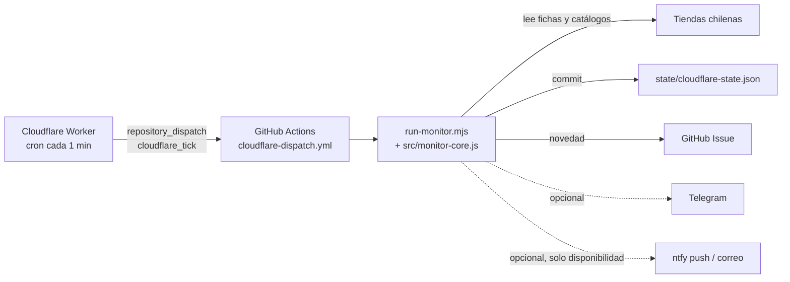

# Monitor Chile — Nintendo Switch 2 Edición Zelda 40 Aniversario

Monitor que avisa cuando aparece **stock o preventa** de la Nintendo Switch 2 – The Legend of Zelda 40th Anniversary Edition en tiendas chilenas.

> **Crédito:** fork de [jsantiscl/switch2-zelda-stock-cl](https://github.com/jsantiscl/switch2-zelda-stock-cl), creado por **Jethro Santis** ([@jsantiscl](https://github.com/jsantiscl)). La lógica de monitoreo y la arquitectura Cloudflare → GitHub Actions son suyas; este fork la adapta y agrega tiendas, detección de región, avisos por ntfy y un modo de prueba en seco.

## Qué hace

- Revisa fichas de producto, catálogos de grandes tiendas, la Tienda Oficial Nintendo de Mercado Libre, Zona Gamer Iquique y búsquedas web.
- Solo acepta productos que mencionan **Switch 2 + Zelda + 40 aniversario** (no juegos, amiibos ni accesorios).
- Ignora páginas anti-bot, errores y lecturas no concluyentes.
- Exige **dos lecturas fiables consecutivas** antes de avisar que algo pasó a disponible.
- La **primera ejecución** guarda una línea base: las fichas fijas no avisan lo que ya estaba disponible; en los catálogos (Falabella, PC Factory…) lo que ya está disponible sí se avisa tras la doble lectura.
- Detecta la **región/versión** de cada ficha (americana, Hong Kong, japonesa ⚠️, europea, global).
- En el marketplace de Falabella registra el **vendedor** y marca con ⚠️ cuando no es Falabella.
- Avisa por **GitHub Issue** (siempre), **Telegram** (opcional) y **ntfy** push/correo (opcional).

## Arquitectura



El cron de GitHub Actions no baja de 5 minutos y suele retrasarse, así que el Worker de Cloudflare (`cloudflare/src/index.js`) solo hace de reloj: cada minuto pide a GitHub que ejecute el workflow. Si todavía hay una corrida activa, se salta ese minuto. El estado se guarda como commit en `state/cloudflare-state.json`.

### Frecuencias

| Qué | Cada cuánto |
|---|---|
| Worker de Cloudflare → dispara el workflow | 1 minuto (se salta si hay una corrida activa) |
| Fichas conocidas + Mercado Libre oficial | cada corrida (~1 minuto) |
| Catálogos: Falabella, PC Factory, Bestmart, Ripley, Lider, Sniper | 2 minutos (minutos pares) |
| Zona Gamer Iquique (Facebook y espejo público) | 5 minutos |
| Búsqueda amplia de tiendas nuevas y redes sociales (Bing) | 15 minutos |

Los minutos se cuentan en UTC según la hora programada del tick.

### Fuentes vigiladas

- **Fichas fijas** (`STORES` en `cloudflare/src/monitor-core.js`): Santo Games, Play Service, Mathogames (versión HK), TodoJuegos, WePlay (dos fichas, una HK) y Paris.
- **Catálogos** (`RETAILER_WATCH_PAGES`): Falabella (buscador, con vendedor), PC Factory (API de catálogo), Bestmart, Ripley, Lider y Sniper.
- Mercado Libre · Tienda Oficial Nintendo, Zona Gamer Iquique y búsqueda amplia en Bing.

Zmart y Microplay no están: `zmart.cl` redirige a otra tienda y `microplay.cl` es un dominio en venta.

### Región / versión

Solo se mira el texto de la propia ficha (nombre, descripción, título, meta descripción y GTIN/UPC del JSON-LD), nunca la página completa. Reglas, en orden:

1. "japonesa", "Japón", "Japan" → **⚠️ Japonesa**: solo funciona en japonés y con cuentas japonesas.
2. "Hong Kong", "HK" → Hong Kong.
3. "americana", "USA", "EE.UU.", "Formato US" → Americana.
4. "europea" → Europea. 5. "global" → Global.
6. Sin texto, pero UPC que empieza con `045496` → Americana (Nintendo of America).
7. Si no hay datos → Región no indicada.

El texto explícito gana al UPC porque hay versiones de Hong Kong que traen un UPC `045496`.

### Qué avisa cada canal

| Evento | Issue | Telegram | ntfy push / correo |
|---|:-:|:-:|:-:|
| Ficha pasa a disponible / preventa (tras doble lectura) | ✅ | ✅ | ✅ |
| Ficha nueva disponible (catálogo o búsqueda) | ✅ | ✅ | ✅ |
| Cambio de precio de algo disponible | ✅ | ✅ | — |
| Posible publicación en redes / Zona Gamer | ✅ | ✅ | — |
| Producto agotado, página caída o bloqueada | — | — | — |

## Configuración paso a paso

Requisitos: cuenta de GitHub, cuenta gratuita de Cloudflare, [GitHub CLI](https://cli.github.com/) y Node.js 22.

### 1. Activar Actions e Issues en el fork

GitHub los deja desactivados en los forks.

```bash
gh api -X PUT repos/<tu-usuario>/switch2-zelda-stock-cl/actions/permissions -F enabled=true -f allowed_actions=all
gh repo edit <tu-usuario>/switch2-zelda-stock-cl --enable-issues
```

También se puede en la web: pestaña **Actions** → *I understand my workflows, go ahead and enable them*, y **Settings → General → Features → Issues**.

### 2. Secrets de avisos (todos opcionales)

Si un canal no está configurado, se omite sin romper nada.

```bash
gh secret set TELEGRAM_BOT_TOKEN   # token de @BotFather
gh secret set TELEGRAM_CHAT_ID     # ID del chat o grupo
gh secret set NTFY_TOPIC           # nombre del topic de ntfy
gh secret set NTFY_EMAIL           # correo para recibir el aviso también por email
```

`gh secret set` pide el valor por consola, así que no queda en el historial. Para encontrar el `TELEGRAM_CHAT_ID`, escríbele al bot (o agrégalo a un grupo y envía `/start`) y ejecuta el workflow **Probar avisos**: lista los chats que ve el bot.

**ntfy:** instala la app [ntfy](https://ntfy.sh/) (Android/iOS), toca **+** y suscríbete a tu topic en el servidor `ntfy.sh`. Cualquiera que conozca el nombre del topic puede leer y publicar en él, así que usa uno largo y difícil de adivinar. El plan gratuito de ntfy.sh limita los correos por día.

### 3. Token de GitHub para el Worker

Crea un **Fine-grained personal access token** en GitHub → **Settings → Developer settings → Personal access tokens → Fine-grained tokens → Generate new token**:

- **Repository access:** *Only select repositories* → solo tu fork.
- **Permissions → Repository permissions:**
  - **Contents: Read and write** (lo exige `POST /repos/{repo}/dispatches`).
  - **Actions: Read-only** (para ver si hay una corrida activa y no duplicarla).
  - *Metadata: Read-only* se agrega sola.

No necesita permisos de Issues: los Issues y el commit del estado los hace el workflow con el `GITHUB_TOKEN` automático de Actions.

### 4. Desplegar el Worker

Revisa que `GITHUB_REPOSITORY` en `cloudflare/wrangler.jsonc` sea `<tu-usuario>/switch2-zelda-stock-cl`.

```bash
cd cloudflare
npx wrangler login
npx wrangler secret put GITHUB_TOKEN
npx wrangler deploy
```

`wrangler secret put` pide el token por consola. Opcional: `npx wrangler secret put RUN_TOKEN` habilita `POST /run` para disparar una revisión manual con `Authorization: Bearer <RUN_TOKEN>`.

## Cómo verificar que está corriendo

1. **Worker:** abre `https://switch2-zelda-stock-cl.<tu-subdominio>.workers.dev/health`. Debe responder `"ok": true`, `"github_token_configured": true` y tu repositorio en `github_repository`.
2. **Logs del Worker:** `npx wrangler tail` (o Cloudflare → Workers → *Logs*) muestra `DISPATCH OK` cada minuto, o `DISPATCH SKIPPED` si la corrida anterior sigue activa.
3. **GitHub Actions:** en la pestaña **Actions** aparecen corridas "🤖 Cloudflare → GitHub · <hora>" cada minuto o dos. El *Summary* de cada una muestra la tabla de tiendas con estado, precio, región y vendedor.
4. **Estado:** tras la primera corrida, `state/cloudflare-state.json` pasa a `"initialized": true` y aparecen commits `chore: actualizar estado Cloudflare monitor [skip ci]` cuando algo cambia.
5. **Avisos:** Actions → **Probar avisos** → *Run workflow* envía un mensaje de prueba a cada canal configurado.

Para detenerlo: `npx wrangler delete` en `cloudflare/`, o desactiva el workflow en Actions.

## Pruebas locales

```bash
node cloudflare/selftest.mjs
```

```bash
DRY_RUN=1 node cloudflare/run-monitor.mjs
```

En PowerShell: `$env:DRY_RUN=1; node cloudflare/run-monitor.mjs`. El modo seco usa el estado local, revisa todas las fuentes y muestra la tabla de tiendas, pero no hace commit, no crea Issues ni envía avisos, y no necesita tokens.

## Agregar una tienda

- **Ficha fija:** agrega `{ name, url }` a `STORES` en `cloudflare/src/monitor-core.js`.
- **Catálogo:** agrega `{ name, url }` a `RETAILER_WATCH_PAGES`. Se buscan enlaces que cumplan Switch 2 + Zelda + 40 y se inspecciona cada ficha. Si la fuente es JSON o la ficha está protegida, agrega un `parse` como `falabellaResults` o `pcFactoryResults`.

## Limitaciones

- Ningún scraper es 100 % fiable: cambios de diseño, CAPTCHA o anti-bot (hoy WePlay, Ripley y a veces Lider, Bestmart y Sniper) dejan lecturas "no concluyentes" que se ignoran. Confirma siempre en la tienda antes de comprar.
- Falabella se lee desde su buscador porque la ficha está protegida por Cloudflare; se asume que el buscador solo lista productos con stock.
- Algunos antivirus (por ejemplo, Bitdefender) marcan `monitor-core.js` como sospechoso porque envía datos a la API de Telegram con un token, el mismo patrón que usan algunos troyanos. Es un falso positivo; si te pasa, excluye la carpeta del repositorio.
